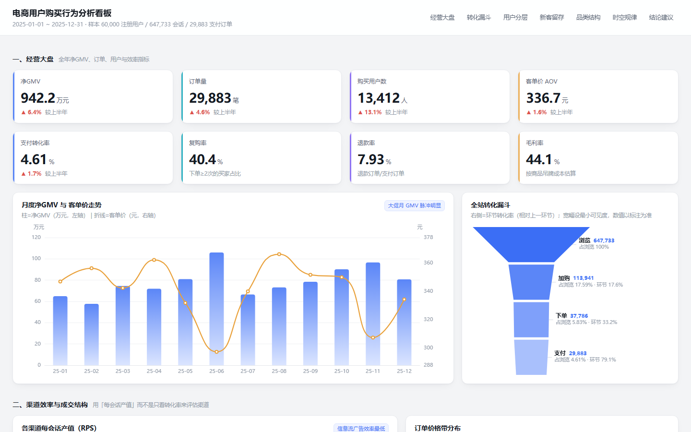

# 电商用户购买行为分析

基于 64.8 万访问会话与 2.99 万支付订单，构建从原始数据到决策建议的完整分析链路，
覆盖经营大盘、转化漏斗、渠道效率、用户分层、留存与品类结构六个模块，并输出可交互数据看板。

**在线看板**：<https://syk20040325-cyber.github.io/ecommerce-user-behavior-analysis/>

[](https://syk20040325-cyber.github.io/ecommerce-user-behavior-analysis/)

---

## 一、项目概览

针对一个电商平台的全量行为数据，回答三个业务问题：

1. **增长来自哪里** —— 拉新还是老客复购？
2. **钱漏在哪里** —— 浏览→加购→下单→支付，哪一环损耗最大？
3. **预算该投给谁** —— 渠道 / 用户分层 / 品类之间的效率差有多大？

数据集为**按公开电商业务规律合成的模拟数据**（详见「数据说明」），因此结论的**方向**具有参考意义，
具体数值不对应任何真实企业。

分析框架与主要结论：

| 模块 | 方法 | 关键发现 |
|---|---|---|
| 经营大盘 | 月度趋势、H2 vs H1 环比 | 买家数 +13.1% 而净 GMV 仅 +6.4%，增长靠"更多人买"而非"买更多" |
| 转化漏斗 | 会话级四阶漏斗 + 渠道/设备切片 | 漏点在「加购→下单」（33.2%），支付环节 79.1% 属健康水平 |
| 渠道效率 | 每会话产值 RPS（净 GMV ÷ 会话） | 信息流 ¥6.22 vs 私域 ¥19.78，相差 3.2 倍 |
| 用户分层 | RFM 八分群 + 帕累托 | 18.2% 用户贡献 48.8% GMV；但预算应投「重要保持客户」而非头部人群 |
| 留存分析 | 新客次月留存 + 月度 Cohort 矩阵 | 首购后 1 个月留存跌至约 20%，此后不再衰减（首购即分层） |
| 品类结构 | 份额 × 份额增速四象限 + 毛利/退款校验 | 美妆=明星、3C=现金牛、女装=高 GMV 低质量 |

---

## 二、目录结构

```
电商用户行为分析/
├── data/raw/                  # 原始数据（5 张表，共 44MB，可由生成器复现，默认不入库）
│   ├── users.csv              # 6 万注册用户
│   ├── products.csv           # 900 个 SKU
│   ├── sessions.csv           # 64.8 万访问会话（含漏斗层级）
│   ├── orders.csv             # 2.99 万支付订单
│   └── order_items.csv        # 订单商品明细
├── src/
│   ├── generate_data.py       # Step 0：可复现的数据生成器
│   └── analysis.py            # Step 1：全部指标计算，输出看板数据 + 指标摘要
├── dashboard/
│   ├── index.html             # 交互式看板（单文件，双击即开）
│   └── assets/js/
│       ├── echarts.min.js     # 本地 ECharts，离线可用
│       └── data.js            # 分析结果（由 analysis.py 生成）
├── reports/
│   ├── 分析报告.md            # 完整分析报告（含行动建议与预估收益）
│   └── metrics.txt            # 所有关键指标的纯文本摘要
├── docs/preview.png           # 看板预览图
├── index.html                 # 站点入口，跳转到 dashboard/
├── .nojekyll                  # 关闭 GitHub Pages 的 Jekyll 处理
└── README.md
```

---

## 三、运行方式

```bash
# 1. 安装依赖（仅 pandas / numpy）
pip install pandas numpy

# 2. 生成数据（约 40 秒，固定随机种子可复现）
python src/generate_data.py

# 3. 计算指标，生成看板数据
python src/analysis.py

# 4. 打开看板
#    直接双击 dashboard/index.html 即可（无需起服务、无需联网）
```

---

## 四、数据说明

`src/generate_data.py` 按电商业务中常见的规律构造数据，包括：

- 渠道间转化率与客单价的结构性差异（私域 > 自然搜索 > 直播 > 信息流）
- 大促期间的流量与转化脉冲（双 11、618、99、双 12 等节点）
- 用户价值分层（购买频次、客单价、活跃周期呈明显长尾分布）
- 品类间的退款率、毛利率与年度增速分化
- 周末与工作日的下单时段分布差异

随机种子固定，任何人 clone 后重跑可得到完全一致的结果。数据不含任何真实用户信息。

**接入真实数据**：把 `data/raw/` 下 5 个 CSV 换成自己的埋点导出（保持字段名一致），
重跑第 3 步即可，看板与报告全部自动更新，分析代码无需改动。

---

## 五、指标口径与设计决策

以下口径选择对结论影响较大，单独说明：

**1. 用净 GMV 而不是 GMV**
GMV 含退款，会让业绩虚高。净 GMV = 实付 − 退款。女装品类尤其明显：GMV 排名第一，
但退款率 14.5%（全站均值 7.9%），用净额口径后其真实贡献大幅缩水。

**2. 渠道不用转化率排名，而用「每会话产值 RPS」**
转化率只看成交概率，忽略客单价。信息流 CVR 1.89% 但客单价 ¥348，私域 CVR 6.23% 客单价 ¥336，
单看转化率会得出"信息流不算太差"的错误判断；RPS（¥6.22 vs ¥19.78）才反映真实流量效率。

**3. 品类增长用「份额增速」而不是绝对增速**
下半年有双 11，所有品类绝对值都会上涨。用「下半年份额 ÷ 上半年份额 − 1」剔除大盘季节性，
才能识别谁在真正抢份额（女装 −9.7%、运动户外 +41%）。

**4. 新客定义带时间窗**
注册 90 天内完成首购才算新客。若不加时间窗，分析窗口首月会把所有首单都计为新客，
新客占比会假性冲高至 80% 以上。

**5. 漏斗图做最小可见度处理并明确标注**
64.8 万 → 2.99 万，等比渲染时末层会细到不可见。图宽设置保底值，并在副标题注明
"数值以标注为准"——视觉调整不隐藏。

**6. RFM 分群后给出「该投谁」的判断**
重要价值客户（18.2% 人数 / 48.8% GMV）最近 34 天仍在购买、人均 5.6 单，本身处于自转状态；
真正值得投放的是「重要保持客户」：1,446 人、历史 3.4 单、客单价 ¥431、已沉睡 154 天。

---

## 六、已知局限

- 数据无页面级埋点，路径分析只能定位到"最大流失环节"，无法做逐页归因
- 数据无投放花费字段，RPS 无法进一步转化为 ROI / LTV / CAC
- 留存采用订单口径（数据无登录或活跃表），会低估"回来浏览但未下单"的用户
- 品类分析未接入供应链成本明细，毛利按品类平均成本率估算
